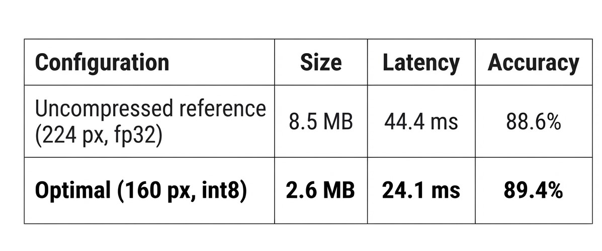

# RipenessAI — Compressing a Fruit-Ripeness Classifier for Edge Deployment

A multi-axis compression study of a banana-ripeness classifier
(Green / Semi-ripe / Ripe / Overripe), answering:

> *How much can a fruit-ripeness classification model be compressed for edge
> deployment before its predictive performance becomes meaningfully worse?*

## Headline result



**3.25× size reduction · 1.84× end-to-end speedup · +0.8 pt accuracy.**
Latency improvement is attributed primarily to the 49% per-image compute
reduction from 160×160 inputs; int8 quantisation contributes size reduction
but not latency reduction on host x86 CPUs (see report ).

## Research question answered

> MobileNetV2 can be compressed **3.25× in size** (fp32 → int8) at **160×160**
> resolution with **zero accuracy loss**, and a +0.8 pt gain over the
> 224×224 reference. Below 160×160, accuracy degrades (87.8% at 128×128).
> Width compression (α < 1.0) cannot be evaluated cleanly on this dataset
> because no pretrained ImageNet checkpoints exist at reduced widths;
> training from scratch collapses to chance (see report §4).

## Pipeline

```

data/ ← BananaImageBD (not committed; see below)
src/
verify_no_leakage.py leakage verification (must run first)
audit_dataset.py data audit
eda.py exploratory data analysis
train_baseline.py baseline + MobileNetV2 two-stage fine-tuning
error_analysis.py class-wise confusion + misclassified gallery
compression.py multi-axis sweep (width × resolution)
quantise.py fp32 / fp16 / int8 post-training quantisation
benchmark.py size / latency / accuracy measurement
reports/ ← all results (committed)
models/ ← trained weights (not committed; regenerate)

```

## Dataset

BananaImageBD — Mendeley Data, DOI 10.17632/ptfscwtnyz.2.

Not included in this repository. Download and extract per Reproduce above.

Key findings:

**Resolution sweet spot at 160×160**: beats 224×224 by +0.8 pts while
reducing compute by 49%.

**Width compression ruled out**: all α < 1.0 variants collapse to chance
when trained from scratch on ~1500 images (see report §4 for the
width/initialisation confound).

**No leakage**: verified in src/verify_no_leakage.py — real splits share
zero originals; augmented images excluded from training entirely.

## Reproduce

# Obtain BananaImageBD from Mendeley Data
# (DOI 10.17632/ptfscwtnyz.2), extract to:
#   data/real/{Green,Semi-ripe,Ripe,Overripe}/
#   data/augmented/{Green,Semi-ripe,Ripe,Overripe}/

```

python src/verify_no_leakage.py
python src/audit_dataset.py
python src/eda.py
python src/train_baseline.py --model baseline
python src/train_baseline.py --model mobilenet
python src/error_analysis.py --model mobilenet
python src/compression.py
python src/quantise.py
python src/benchmark.py

```

Full write-up: reports/
