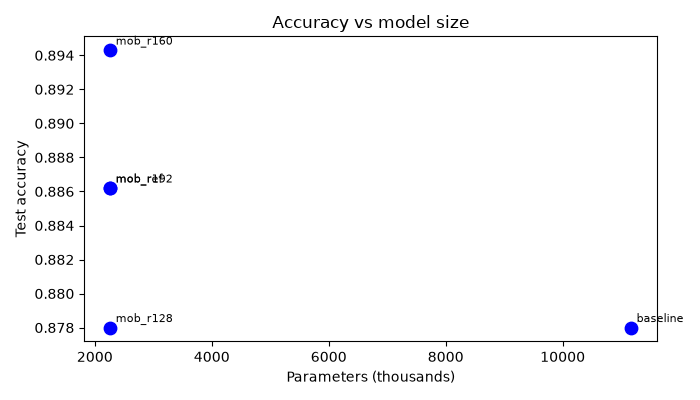
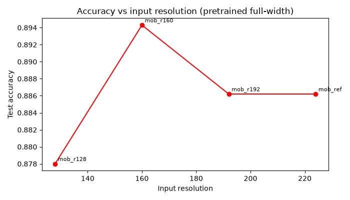

# Compression Study

> Two axes swept: model width (alpha) and input resolution. All runs use the same seed and train/test split.

| Config | Kind | Alpha | Res | Pretrained | Params | Keras KB | Accuracy | Macro F1 |
|---|---|---:|---:|:---:|---:|---:|---:|---:|
| baseline | custom | - | 224 | no | 11,169,476 | 130941.1 | 0.878 | 0.878 |
| mob_ref | mobilenet | 1.0 | 224 | yes | 2,263,108 | 9462.8 | 0.886 | 0.888 |
| mob_a75 | mobilenet | 0.75 | 224 | no | 1,387,188 | 16741.7 | 0.252 | 0.101 |
| mob_a50 | mobilenet | 0.5 | 224 | no | 711,348 | 8884.9 | 0.252 | 0.101 |
| mob_a35 | mobilenet | 0.35 | 224 | no | 415,332 | 5450.8 | 0.260 | 0.103 |
| mob_r192 | mobilenet | 1.0 | 192 | yes | 2,263,108 | 9462.8 | 0.886 | 0.886 |
| mob_r160 | mobilenet | 1.0 | 160 | yes | 2,263,108 | 9462.8 | 0.894 | 0.891 |
| mob_r128 | mobilenet | 1.0 | 128 | yes | 2,263,108 | 9462.5 | 0.878 | 0.877 |

## Accuracy vs size

## Accuracy vs resolution

> Note: alpha<1.00 rows are trained from scratch (no ImageNet weights exist at those widths); they collapse to chance, indicating that width compression is not viable on this dataset.
