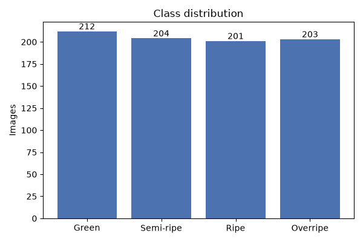
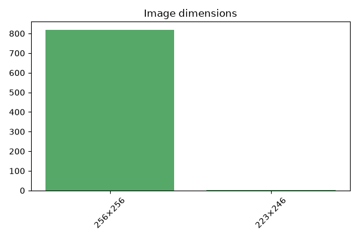
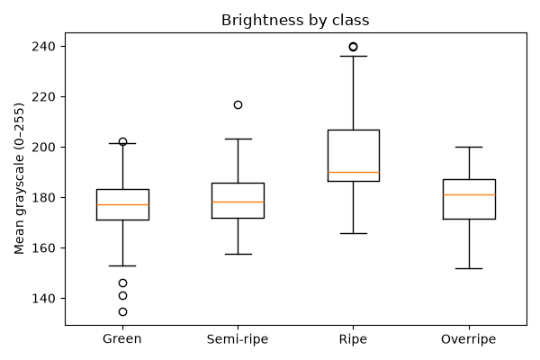
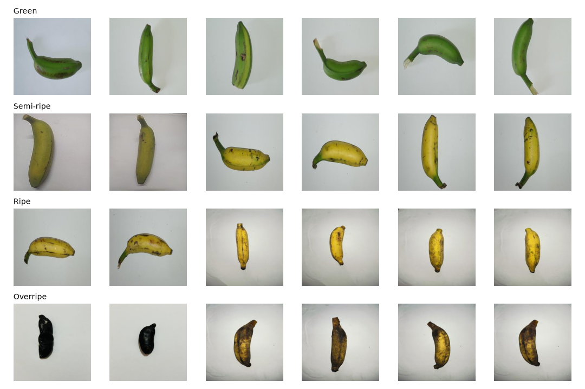

# EDA

## Class balance

| Class | Count | Share |
|---|---:|---:|
| Green | 212 | 25.9% |
| Semi-ripe | 204 | 24.9% |
| Ripe | 201 | 24.5% |
| Overripe | 203 | 24.8% |

>  Balanced

## Dimensions

| Size | Count |
|---|---:|
| 256×256 | 819 |
| 223×246 | 1 |

## Brightness

| Class | Mean gray |
|---|---:|
| Green | 177.1 |
| Semi-ripe | 178.4 |
| Ripe | 195.7 |
| Overripe | 179.1 |

> Spread = 18.5 ( small)

## Figures

