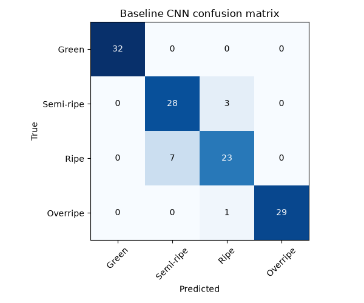
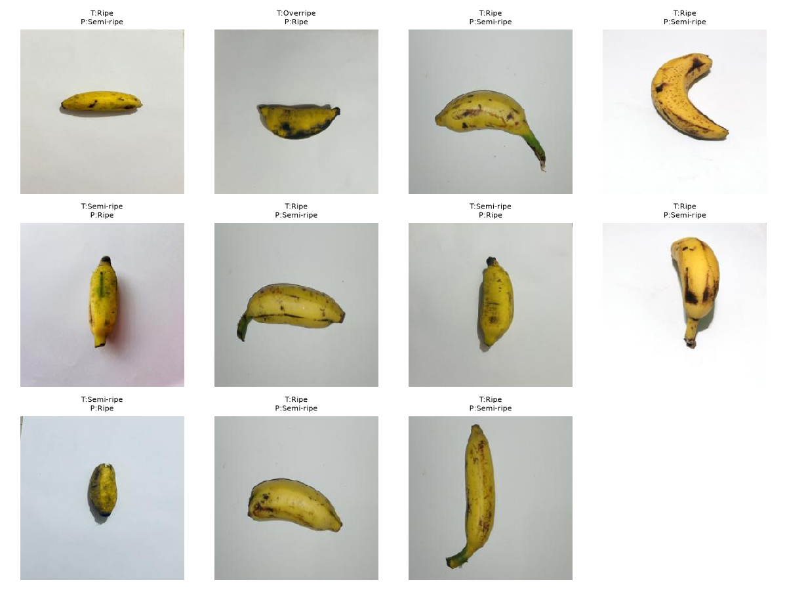

# Error Analysis — Baseline CNN

## Per-class metrics

```
              precision    recall  f1-score   support

       Green      1.000     1.000     1.000        32
   Semi-ripe      0.800     0.903     0.848        31
        Ripe      0.852     0.767     0.807        30
    Overripe      1.000     0.967     0.983        30

    accuracy                          0.911       123
   macro avg      0.913     0.909     0.910       123
weighted avg      0.913     0.911     0.911       123

```

## Top misclassification pairs

| True → Predicted | Count |
|---|---:|
| Ripe → Semi-ripe | 7 |
| Semi-ripe → Ripe | 3 |
| Overripe → Ripe | 1 |

## Figures




