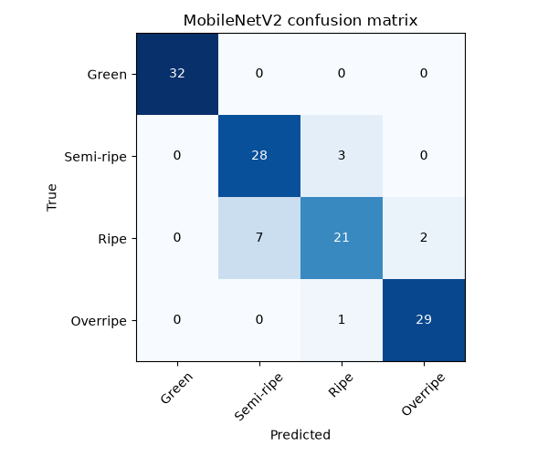
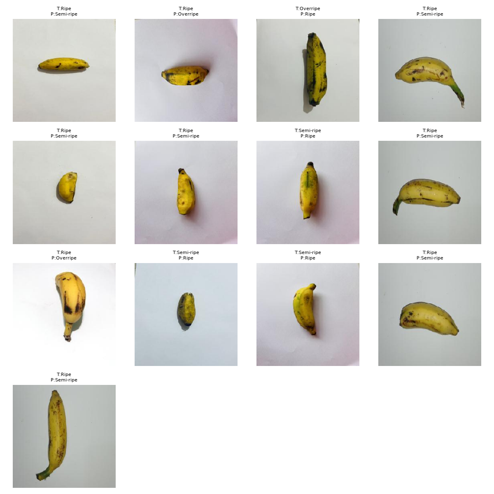

# Error Analysis — MobileNetV2

## Per-class metrics

```
              precision    recall  f1-score   support

       Green      1.000     1.000     1.000        32
   Semi-ripe      0.800     0.903     0.848        31
        Ripe      0.840     0.700     0.764        30
    Overripe      0.935     0.967     0.951        30

    accuracy                          0.894       123
   macro avg      0.894     0.892     0.891       123
weighted avg      0.895     0.894     0.892       123

```

## Top misclassification pairs

| True → Predicted | Count |
|---|---:|
| Ripe → Semi-ripe | 7 |
| Semi-ripe → Ripe | 3 |
| Ripe → Overripe | 2 |
| Overripe → Ripe | 1 |

## Figures




